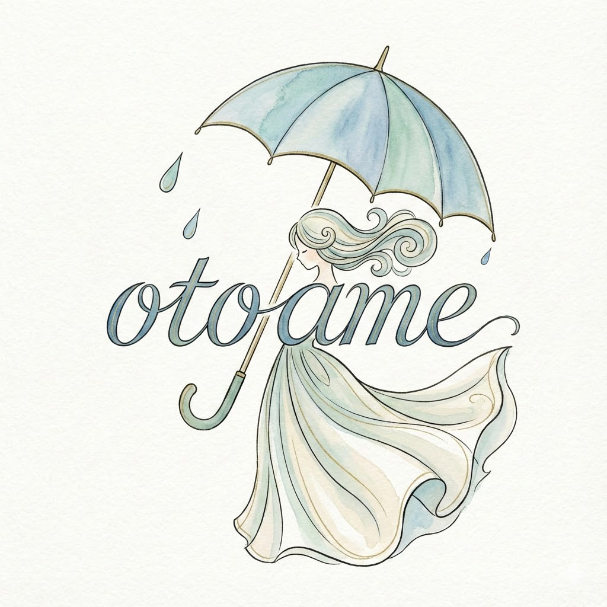

# OtoAme

OtoAme 是以乙女游戏为核心的视觉小说社区，免费提供游戏资料检索、资源分享与玩家交流。本仓库是 [OtoAme 网站](https://www.otoame.top)的完整源码。

[网站](https://www.otoame.top) · [落地页](https://otoa.me) · [Telegram 频道](https://t.me/otoame) · [维护文档](docs/README.md) · [问题反馈](https://github.com/OtoAme/kun-otoame-next/issues)

## 由来

乙女游戏社区相对封闭，资源分散在贴吧、论坛和各类网盘中。老作品的官网关闭、商店下架后，玩家往往要花很多时间搜寻资料，网盘分享失效又会让作品逐渐「失传」。OtoAme 希望为乙女游戏玩家提供一个稳定、开放、免费的资料与资源聚合平台，并鼓励玩家在体验后购买正版支持开发者。

站点以乙女游戏为核心，同时收录一般向、BL、GL 等其他类型的视觉小说，以及少量剧情出色的其他游戏。收录理念与版权声明见站内的[关于我们](posts/notice/about.mdx)。

程序派生自 [KUN1007/kun-touchgal-next](https://github.com/KUN1007/kun-touchgal-next)，后者又源于 [kun-galgame-patch-next](https://github.com/KUN1007/kun-galgame-patch-next)。本项目在上游基础上面向乙女游戏重新设计了内容分类，并补充了投稿审核、用户工作台、链接维护和私聊等能力。上游原始说明保存在 [README_touchgal.md](README_touchgal.md)，其中的配置与部署方式不适用于本项目。

## 功能

| 面向 | 功能 |
| --- | --- |
| 读者 | 游戏条目汇集介绍、截图画廊、标签、会社与外部资料；按关键词、标签和会社检索，可排除标签或屏蔽成人内容。 |
| 下载 | 资源按游戏、补丁和平台分类，标注中文支持情况；支持常见网盘与站内对象存储，游客也可在额度内获取。 |
| 交流 | 评论与评价、站内私聊（图片与贴纸）、首页小喇叭公告，以及签到和萌萌点激励。 |
| 贡献者 | 投稿新游戏条目并经管理员审核；在已有条目下发布资源；在用户工作台集中管理本人条目、资源和收到的问题。 |
| 链接维护 | 读者检测链接或反馈失效，发布者回应、暂缓或停止维护，网站按反馈汇总链接可用状态。 |
| 站方 | 管理后台集中处理待审投稿、资源申请和问题反馈，并提供用户管理、统计与运维工具。 |
| 外观 | Classic 与 Pink 两套配色，均支持浅色和深色模式。 |

各项功能的权限、费用、额度和时限以[权限与业务规则](docs/modules/api-services.md)为准。仓库包含实现，不代表某项功能已在线上启用。

## 技术栈

Next.js 15（App Router）与 React 19，TypeScript；PostgreSQL 经 Prisma 7 访问，Redis 承担缓存、限频与计数；前台使用 HeroUI，工作台与新后台使用 shadcn/ui，样式基于 Tailwind CSS 4；文件存放在 S3 兼容的对象存储。运行环境为 Node.js 24.22.1（见 [.nvmrc](.nvmrc)）与 pnpm。

## 开始使用

| 你要做的事 | 从这里开始 |
| --- | --- |
| 了解系统由哪些部分组成 | [架构与职责](docs/project/overview.md) |
| 在本地运行一个开发站点 | [本地开发指南](docs/project/development.md) |
| 发布到服务器或回退版本 | [部署与应用恢复](docs/project/deployment.md) |
| 执行数据库迁移与日常维护 | [运维操作指南](docs/modules/operations.md) |
| 查看全部维护文档 | [维护文档导航](docs/README.md) |

本地开发需要 Node.js、pnpm、PostgreSQL 与 Redis，并且只能使用可丢弃的开发数据库。初始化命令会同步数据库结构，不能指向已有数据的库。

## 参与贡献

**贡献内容**：注册网站账号后即可投稿游戏条目或发布资源，流程见站内的[内容贡献指南](posts/notice/contribute.mdx)。条目资料有误时，在游戏页面的「游戏反馈」中提交更正。

**贡献代码**：

1. 先阅读[项目协作指引](AGENTS.md)，再按[技能分工](skills/README.md)阅读相关领域的说明。
2. 在隔离环境完成修改，按[测试指南](docs/project/testing.md)运行与改动相称的检查。
3. 行为变化时同步更新对应的维护文档，提交信息采用[约定式提交](https://www.conventionalcommits.org/zh-hans/v1.0.0/)。
4. 向本仓库提交 Pull Request，说明改动内容、验证结果和未验证的风险。

本改版的问题请在当前仓库反馈，不要提交到上游仓库。其他事宜可以通过[电子邮件](mailto:contact@otoame.com)联系运营组，更新动态发布在 [Telegram 频道](https://t.me/otoame)。

## 许可

本项目以 [AGPL-3.0-only](LICENSE) 许可发布，保留上游作者的版权与署名。修改后分发，或以修改后的程序提供网络服务时，须按许可证公开相应源码。本仓库只包含网站程序，不包含任何游戏资源；站内资源的版权归原权利人所有。
