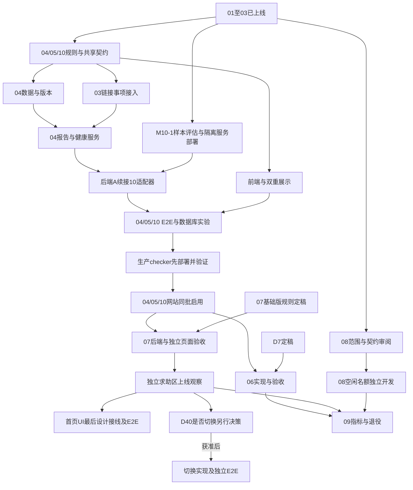

# 运营层后续 worker 编排计划

核对日期：2026-10-08。代码基点：`main` 的 `37c61c2c1d9b7326a11d5f33d8cb65527da6847d`，与本地 `origin/main` 引用一致；本轮未 fetch。站长在本轮确认模块 03 **已验收并上线**。本文记录需求拆解与派发方案；2026-10-09 已完成 04／05／10 首批本地实现，技术验收与尚未生产部署的边界见[首批验收记录](./12-first-batch-acceptance.md)。

2026-10-09 执行安排：按用户最新要求，主会话合并编排与主要审阅职责，**包括主会话在内最多一个 Astra，不再派额外 Astra worker**。已停止原独立主审会话，保留并复用其已完成结论；Sol 后端与 K3 前端沿原作者会话继续、权限保持对应 auto 档。后续只传递增量任务和必要问题，不重复读取长文或重跑仍有效的检查。W00、数据、事项、健康服务、检测服务及适配器、前端与文档已交付并完成主审；全量、真实数据库、HTTP 与浏览器证据统一记录在首批验收记录。

产品规则以各模块最新已定决定为准；03 的 D38–D40 优先于早期设计基线及 05、07 尚未同步的段落。本文不替站长批准待定产品规则，也不把未来任务标成已完成。

## 1. 当前执行位置

01、02、03 已上线；**04 链接健康 + 05 入口分流 + 10 检测接入与公开结果**已完成首批本地实现与技术验证，开发库已备份并同步。2026-10-12 站长验收中报告前端问题，当前先保存实现基线，再按具体问题逐项修复和复验；用户验收及生产部署尚未完成。06、07 等后续模块仍按下方依赖与产品关口推进，首页 UI 最后上线。

| 模块          | 当前状态与证据                                                                                                 | 接下来需要完成什么                                                               |
| ------------- | -------------------------------------------------------------------------------------------------------------- | -------------------------------------------------------------------------------- |
| 01 后台地基   | 总计划已记录站长确认生产正常使用；控制台、收件箱和预览代码存在                                                 | 后续模块接入现有后台；09 最终核对旧路由                                          |
| 02 小喇叭     | 总计划已记录站长确认部署；后续还有缓存优化及删除过期官方公告的实现                                             | 复用现有沟通能力，不重新实施                                                     |
| 03 事项系统   | 站长于本轮确认已验收、已上线；M03-1～11 已交付，最新代码还含 D38–D40 和弹窗焦点修复                            | 固定为后续接入基线，不重新跑整套已验收开发流程                                   |
| 04 链接健康   | 稳定 ID／版本、完整编辑基点、报告与健康服务、任务和收件箱已实现；真实数据库与浏览器验收通过                     | 随首批完成站长验收、生产迁移及发布                                             |
| 05 入口分流   | 两步目标／现象、强弱证据、资源违规与 D38–D40 兼容接线已实现；实际浏览器分支验收通过                           | 随 04／10 发布；后续入口切换仍需对应模块与决定                                  |
| 06 官方镜像   | 计划已按管理员合并推荐、站方接管原卡片修订；本轮未发现实现代码                                                 | 关键资源说明默认保留且不可一键清空；落实混合备注、匿名、多贡献者细则后实施       |
| 07 求助区     | 2026-10-28 站长审定基础版范围与 D8 参数；首页栏目最后交付，D40 上线观察后另行决策                              | 实现独立求助区；首页栏目另批，迭代项上线后逐项决定           |
| 08 纠错投稿   | 设计草稿；已有普通投稿，尚无本计划的纠错类型和审核闭环                                                         | 依赖 01 已满足，可独立开发；共享收件箱与入口接入串行整合                         |
| 09 指标与退役 | 设计草稿；已有后台统计不是本模块完整运营指标与退役交付                                                         | 按已确认只读归档方向，等生产者事实交付后接查询和退役                             |
| 10 链接检测   | 固定加固服务、夸克限定样本准入、真实适配器与网站接线已完成；独立服务与受控 HTTP／浏览器验收通过                | 确定生产主机及独立出口，先部署并验收 checker，再发布网站                        |

阶段 0 的公告、维护清单和演练勾选仍有历史缺口；本次没有核验公告发布与真实维护记录，不补写为完成，也不因此重新阻塞已经上线的 01～03。

证据入口：

- [03 PM 第 9 节](./03-case-system-pm.md)：M03-11 记录全量 2785 项通过、隔离数据库 18 项、自然调度、生产构建产物浏览器验证。它们是对应版本的历史证据，不是本轮重新执行的结果。
- [03 决定与占位登记](./03-case-system.md#122-后续模块占位登记)：后续类型、目标、结论、入口与超时分工的唯一登记处。
- [资源写入](../../app/api/patch/resource/update.ts)、[资源 schema](../../prisma/schema/patch-resource.prisma)：04 的稳定 ID、版本和完整编辑基点已实现，验证证据见首批验收记录。
- [入口常量](../../constants/issueTriage.ts)、[事项常量](../../constants/case.ts)：05 的已交付部分和后续占位；占位不等于业务已开放。
- 最近相关提交：`e16111ba`（D37）、`fd45240f`（链接失效指引）、`4bfe87bd`（管理员结案理由）、`144a1439`（D40）、`37c61c2c`（事项弹窗焦点）。本轮不据本地 Git 引用推断生产部署的精确 SHA。

## 2. 派发前先对齐的规则

### 已定规则：直接继承

下表记录派发前继承的 03 行为与本批改造目标；本批实现已停止新建临时链接失效事项，并开放资源违规分流，当前行为以首批验收记录为准。

| 位置                             | 当前行为                                                           | 后续 worker 必须保持的约束                                           |
| -------------------------------- | ------------------------------------------------------------------ | -------------------------------------------------------------------- |
| 资源卡片                         | 六个可提交现象，加“下载慢”指南；资源违规项尚未开放                 | 05 复用 `ReportResourceButton` 和 `issueTriage.ts`，不再建第二个入口 |
| 解压／运行、求资源、资源其他问题 | D40 已允许建事项；普通资源先交发布者，官方资源交站方               | 04／05 不得按旧稿改成仅指南；07 改去向须先定稿                       |
| 条目页反馈                       | D38 后共五项；发错条目与链接失效只引导到资源；求资源可提交站方事项 | 05 保留五项与目标语义，链接失效指引随新报告入口一起更新              |
| 不在受理范围结案                 | D39：管理员写理由即可；发布者仍须附指南                            | 不因复用表单把两侧要求合并                                           |
| 删除资源后的事项                 | D37：资源类事项保留历史发布者参与关系，不因目标删除自动结案        | 04 的删除补偿只关闭对应的链接类事项，不能把所有资源事项一起关闭      |
| 临时链接失效类型                 | `resource_link_failure` 当前可创建                                 | 04／05 上线停止新建；存量仍按 03 原规则处理，不强制转换或删除        |
| 两套界面                         | 前台与旧后台 HeroUI v2；dashboard 使用 shadcn                      | K3 同时负责两侧前端，按根布局分别复用组件和样式                      |

04／05 派发前应同步它们的 PM／实施计划中与 D38–D40 冲突的段落；07 入口切换的旧承诺也要标明新的决定前置。此项是继承已定需求，不重新请站长批准 D40。

归属口径按对象区分：03 的资源事项按资源作者角色推导处理方；04 的链接事项在 06 上线前按 `storage = 'touchgal'` 归站方。W00 分别写清，不能把链接侧过渡规则套到所有既有资源事项。

### 未定规则：只阻塞依赖任务

| 关口 | 需要站长决定的内容                                                                        | 建议提交给站长的具体方案                                                                                           | 阻塞范围                                                                |
| ---- | ----------------------------------------------------------------------------------------- | ------------------------------------------------------------------------------------------------------------------ | ----------------------------------------------------------------------- |
| G04  | D5/D6 已按建议确认；删除结论文案由执行者落实                                              | 已定：换版本不重开旧事项；固定七天、回复不延期、归属统一；每轮单票、冷却零权重、过期主动重报、未知旧版本不提供资格 | 产品关口已解除；W00 冻结具体字段、接口与验证合同后实施                  |
| G06  | 已定合并推荐＋管理员合并、官方备份下接管原卡片；关键资源说明默认保留且不可一键清空        | 先按同游戏证据对照和原卡片接管细化；混合个人信息由管理员整理，匿名和多贡献者边界落实后实施                         | 06 回填、移交、合并和相关交互                                           |
| G07  | D8 已定（2026-10-28）；求助举报已登记在 03 第 12.2 节 | 独立求助区真实 E2E 后上线；首页栏目与 D40 去向均不作为基础版前置 | 无产品阻塞；首页栏目单独排期 |
| G09  | 09 已定只读归档、历史可查、先新能力后退役；具体统计口径按真实事实核对                     | 先列已有事实和不可追溯缺口，再确定分母、执行者分类与归档方式                                                       | 指标最终口径、数据处置和退役                                            |
| G10  | 已定支持范围按上游实现＋样本通过，提取码按 provider 实际需要；生产目标稍后确定            | 优先评估自部署参考项目的 HTTP 服务；见第 6.1 节，不自行扩大检测范围                                                | 无需再问统一带码许可；逐 provider 核查与隔离服务可并行                  |

08 没有新增的金额或配额产品决定，范围／契约审阅由执行者完成后派发。不同关口分批提出，不要求站长现在一次决定全部后续模块。

2026-10-08 用户已确认首批 D5/D6 建议及 D10 支持范围原则，并指定提取码按上游实际需要处理；首批这些产品关口已解除。04-a 的“链接已移除”文案和枚举由执行者按既有删除结案规则落实；字段名、DTO、锁序、时效技术参数、auto 档与入口兼容性也由执行者在约束内处理，不另设用户审批。生产主机／出口、可能新增费用和实际发布窗口等具体部署方案准备好后再确认，不阻塞隔离环境与样本评估。06 的关键备注保留规则已确认，混合备注整理、匿名、多贡献者细则仍留待施工定稿；07 已完成 Astra/Grok 互审，D8 具体方案仍留待用户审阅；09 按已确认归档方向推进，具体生产操作在产物可审阅后确认。

## 3. 模型与职责

| 角色                     | 模型／入口                                                       | 责任                                                                        |
| ------------------------ | ---------------------------------------------------------------- | --------------------------------------------------------------------------- |
| 编排、主要审阅、最终验收 | `gpt-6-astra`                                                    | 需求裁决、契约、文件归属、DAG、整合和上线批次判定；不默认接管作者的大块实现 |
| 后端作者                 | `gpt-6.1-sol`，不可用时 `gpt-5.6-sol`，再不可用时 `gpt-5.6-luna` | API、服务、schema、迁移、缓存、任务及对应测试；作者修复审阅问题             |
| 前端作者                 | `mkimi` 的 K3；明确不可用时回退 `grok-4.6`                       | 前台 HeroUI v2、dashboard shadcn、状态与 API 接线、前端回归、浏览器自检     |

这是本轮选择，覆盖项目 skill 中旧的 Luna 后端／Sol 审阅分工。实现产物的主要审阅者为 Astra；本份计划按站长新要求由 Grok 4.6 独立审阅，协调者核实意见、修订并裁决，重要修订续接同一 Grok 会话聚焦复核。这不把 Grok 全量审阅自动扩展到每个实现包。普通功能做一次集中审阅，有重要修订时只聚焦复核；权限、并发、迁移、账务加对应真实验证。旧模块文档的 3～5 轮“文档互审”不是新实现的轮次要求。

本轮入口核实：

- 当前工具目录列有 `gpt-6-astra`、`gpt-6.1-sol`、`gpt-5.6-sol`；没有列出 `gpt-5.6-luna`。这不证明 Orca 上游账户一定支持，也不能把 `gpt-6-luna` 当作同名替代。
- 本批通过 Orca 实际复用了两个 `gpt-6.1-sol` 作者会话，Codex 权限为 `--approve-for-me` 对应的 auto review。额外 Astra 审阅会话已按站长要求停止，由主会话接管；后端回退模型本批未使用。
- `mkimi -- --auto` 已在原 Orca 会话完成前端实现、修订及验收脚本准备；实际界面为 Mirasim Kimi K3／Never Ask。站长已授权沙箱内调用及任务相关非 env 代码传递；本批未使用前端回退模型。
- Grok 通过 Orca worker 完成本计划审阅与同会话聚焦复核；启动参数为 `grok-4.6`，终端实际显示 `Grok 4.6 (high)`。本轮已验证计划审阅调用，前端实现能力与 E2E 仍须在实际工作包自检。

执行时核对请求模型与实际返回元数据。仅在明确不支持／不可用且原尝试已退出或结算后，按上述顺序回退；超时、暂时无输出、审批拒绝不是换模型理由。全部候选不可用则记录阻塞，不另选模型。前端回退链为 K3 → Grok 4.6，二者均不可用时记录阻塞；Astra 没有替代授权。审批拒绝须按原因处理，不能通过换模型绕过。推理力度沿入口配置，用户未指定时不强制给所有 worker 加 `max`。

### 3.1 Worker 权限档位

站长已明确要求：后续每次调用 worker，都设置对应入口的 **auto 档**，包括首发、模型回退和会话复用。派发前核对真实启动配置或 TUI 状态；任务仍受文件归属、env 排除、产品待决项和生产操作授权约束。

| 入口                      | 要求的权限档位与参数                                                                                                                                                          | 核实方式                                                                                      |
| ------------------------- | ----------------------------------------------------------------------------------------------------------------------------------------------------------------------------- | --------------------------------------------------------------------------------------------- |
| Codex（Astra／Sol／Luna） | Auto approval review；支持的当前 CLI 使用 `--approve-for-me`，等价配置是 `approvals_reviewer="auto_review"`、`approval_policy="on-request"`、`sandbox_mode="workspace-write"` | 先核对 Orca 实际启动的 CLI 版本／帮助，再确认实际权限配置；不能把模型名或启动提示词当权限证明 |
| mkimi K3                  | 启动器转发官方 Kimi 参数 `mkimi -- --auto`；本机帮助称该档为 Never Ask                                                                                                        | 核对 Kimi 实际模式；`-y` 的 Ask When Needed 是另一个档位                                      |
| Grok 4.6                  | `grok --model grok-4.6 --permission-mode auto`                                                                                                                                | 核对实际 Grok 权限模式；复用终端时也重新核对                                                  |

Codex 参数依据 [OpenAI CLI 源码](https://github.com/openai/codex/blob/main/codex-rs/utils/cli/src/shared_options.rs)，已通过 Context7 查询。普通登录 shell 的 `codex` 仍指向旧版 0.45.0；已核实交互 zsh 实际解析到 `/Users/saya/.nvm/versions/node/v24.11.1/bin/codex`，版本 0.160.1，支持 `--approve-for-me`。本轮以 `zsh -ic 'codex --model gpt-6-astra --approve-for-me'` 启动作者，Orca projection 确认 gpt-6-astra，终端显示 xhigh。继续按实际入口核对，不把旧 --full-auto 当 Auto review；未升级 CLI 或更改全局配置。

`worker-start --agent` 没有已核实的权限覆盖参数：只有确认该 launcher 已使用 auto 才直接派发；否则按已核实的自定义终端流程传入对应参数，等就绪后 `worker-start --terminal`。模型用 `launch.effective` 等运行证据核对，权限另外从实际配置／TUI 核对；复用终端不自动继承本条要求，须检查。

## 4. 并行策略与发布顺序

建议常态为 **1 个 Astra + 最多 3 个活跃 worker**：最多两个后端写者和一个前端写者（K3，不可用时 Grok 4.6）。它是本计划的资源安排建议，不是对外部 CLI 并发上限的断言。所有活跃 worker（包括只读评估）都计入这 3 个名额。W10-evaluate 跨入波次 B 时，data／case／UI 中最多先启动两项，其余排队；评估真实交付结算后再释放名额，不把暂停或未完成当作完成。空闲名额给准备下一模块或验证，不为占满名额拆碎同一事务。

开发与发布分别安排：建议 **04+05+10 → 06 → 07 独立求助区 → 08 → 09**，把检测服务的部署和接入前移到第一批，完整交付本轮已确认的直接判定、冲突复核和双重展示。08 可提前开发并按既有允许方式在阶段 2 后提前发布。checker 是独立运行的服务，但本站检测能力在 04／05 合批验收；不等待 06～09。

07 按 2026-10-28 审定的基础版交付：M07-1～M07-4 与 E07-01～04 通过后上线观察，首页栏目（M07-5）最后单独派发。首页栏目和 D40 观察后决策不阻塞 07 基础版或后续模块。



图中边为业务依赖；checker 测试服务和样本评估可以提前，网站接线必须等 04 契约。ready 任务受并发名额和唯一文件写者约束，图不代表自动同时启动。07 技术上不依赖 06 的合并队列清空；默认优先给 06 实现名额，07 设计持续前置。09 的最终旧后台退役还要等 08 的替代入口就绪。

## 5. 第一批：04／05／10 的可派发工作包

以下 K3 均指前端角色，明确不可用时由 Grok 4.6 承接相同文件归属与验收责任，记录新旧会话交接；不得并存两个前端写者。worker 名是逻辑职责，可以串行复用同一作者会话，不要求每行新开会话。派发时从本表生成完整任务正文，列出实际允许的测试文件，不给笼统的全仓写权限。

| ID／作者                               | 依赖                     | 交付与可写范围                                                                                                                                                                                                                                                                                                                                                                                     | 可观察验收                                                                                                                                                                              |
| -------------------------------------- | ------------------------ | -------------------------------------------------------------------------------------------------------------------------------------------------------------------------------------------------------------------------------------------------------------------------------------------------------------------------------------------------------------------------------------------------- | --------------------------------------------------------------------------------------------------------------------------------------------------------------------------------------- |
| W00-contract／后端，Astra 审定         | G04 已定；最新规则对齐   | 冻结 04/05/10 请求、成功／错误返回、公开／私有 DTO、版本基点、检测快照、机器冲突来源、事项内部调用与锁顺序。后端拥有 `types/api/linkHealth.ts`、`validations/linkHealth.ts`、`constants/linkHealth.ts` 及 `types/api/patch.ts`、`validations/patch.ts`、`types/api/inbox.ts`、`validations/inbox.ts` 的契约改动；03 登记由 Astra 协调                                                              | 前端按真实共享类型写夹具；同时冻结 broken 官方链接的 inbox 新来源、DTO、权限和补链／移除动作合同（types/api/inbox.ts、validations/inbox.ts），随后由 A 单写；决策有记录后才写 sync      |
| W04-data／后端 A                       | W00                      | M04-1/2：`patch-resource.prisma`、新健康 schema、10 最新检测快照和必要反向关系；04 preflight/sync/postflight；资源 `update.ts`、`app/api/patch/resource/download/access/service.ts`、grant/restore、资源 `get.ts` 与后台 DTO、`components/patch/resource/resourcePermissions.ts` 的链接级权限纯函数；四条删除调用链和对应测试                                                                      | 元数据保存保持链接 ID／版本／获取记录；合法删除成功；旧基点零写入；单链接删除保留配额事实；新版本揭示不延期、不重复扣额度，restore 只读                                                 |
| W04-case／后端 B                       | W00；用固定内部契约并行  | `app/api/case/service.ts`、必要的新薄 helper、`constants/case.ts`、`types/api/case.ts`、`validations/case.ts`、`caseTimeoutTask.ts`、相关 case 测试；优先交付可测试的 closeLinkCases 实现，再完善链接事项开启／结案和重开边界，05 资源违规类型开放                                                                                                                                                 | 复用 `openCaseInternal`／`closeCaseInternal`；链接版本去重、身份可见范围、结案一次通知；03 任务不处理链接类；D37/D39/D40 回归保持                                                       |
| W045-ui／K3                            | W00；先夹具后接真 API    | M04-5 + M05-1～5：`components/case/ReportResourceButton.tsx`、`constants/issueTriage.ts`、`components/patch/resource/DownloadCard.tsx`、`ResourceDownload.tsx`、资源编辑组件、`components/dashboard/issue/*` 待修复分组、`FeedbackButton.tsx`、链接提示／表单、新 dashboard 页面和组件、必要前端 hooks／纯渲染 page、前端测试；10 的每链接机器结果／反馈／冲突提示；入口说明及两篇指南中的相关段落 | 选目标→现象→提交完整；弱证据确认、资格不足、版本冲突、重复报告、全部失效折叠；保留 D40；取消确认零写入，失败保留输入；桌面与 390px 不溢出                                               |
| W04-health／后端 A，续接               | W04-data、W04-case       | M04-3/4/5：`app/api/patch/resource/link/*`、`app/api/admin/link-health/*`、`server/tasks/linkHealthTask.ts`、`server/cron.ts`、`tests/unit/cron-registration.test.ts`、后台 inbox 服务／类型／校验、新健康服务与对应测试；完成编辑／删除调用健康 helper 的接线                                                                                                                                     | 报告资格／权重在事务内，达阈值只开一次事项；补链与旧任务交错不污染新版本；站方链接不进发布者队列；suspect/disputed 与 broken 待办不重复                                                 |
| W045-join／各原作者，Astra 整合        | 两个服务包与 UI 自检完成 | 后端 A 修 API／迁移，K3 修 UI，后端 B 仅在 case 接入有真实问题时续接；Astra 维护整合差异、文件归属与验收记录                                                                                                                                                                                                                                                                                       | 实际 DTO 和所有调用点一致，所有旧编辑写入端都已替换；完整路径接真 API；没有只靠 fixture 通过的功能                                                                                      |
| V04510／验证职责，作者执行，Astra 验收 | 集中审阅后的集成版本     | E04-01～04、最新 E05-01～02、E10-01～03，真实 checker HTTP 服务、隔离数据库／Redis／应用副本；报告记录代码 SHA、命令结果与未验项                                                                                                                                                                                                                                                                   | 三个门槛分别通过：§9.1 用户路径生产构建 E2E；E04 迁移／锁／并发／任务实验；最新 E05 与 E10 的直接判定、冲突和公开展示验收。不得用浏览器点击替代数据库实验或用旧“环境类不建待办”否定 D40 |

文件归属补充：

1. W00 结束后，共享 DTO／schema 校验的唯一写者转给后端 A；K3 提变更请求，由 Astra 决定并由 A 修改。K3 拥有 `issueTriage.ts` 的最终 UI 接线，须遵守 W00 的词表合同。
2. W04-case 结束后先冻结其 case 接口；W04-health 若需修改这些文件，先明确移交或续接后端 B，不能两人同时编辑。
3. `update.ts` 的版本递增、历史、健康重置由 A 从 data 阶段负责到 health 阶段；B 不复制补链事务。W00 冻结 `closeLinkCases` 签名，B 先交付其真实实现及目标测试，A 才接四条删除链；此前 A 可并行完成其他数据工作。删除调用与结案能力一起合入，不提交空实现或临时跳过结案。四条删除链与父行锁的整套 E04-01 ⑩ 在 V045 验证，不能凭 A 单包自检关闭此项。
4. 04 schema 和迁移由 A 单写；只有 A 执行该 worktree 的 Prisma Client 生成。`server/cron.ts`、共享收件箱、缓存接线一次只有一个写者。
5. K3 不编辑 API、schema、服务端数据读取 actions 或账务；页面如需新增服务端读取逻辑，由 A 实现对应服务／action，K3 只接渲染。新增依赖或共享样式入口改动先交 Astra 协调。

实际波次：

- 波次 A：规则对齐与 W00；并行做 M10-1 参考服务接入评估与隔离部署，以及 06/D7、07/D8、08 范围的只读准备，不提前实施未批准规则。
- 波次 B：按剩余名额启动 W04-data、W04-case、W045-ui；M10-1 或其他评估 worker 未结算时，三包最多先开两项，全部活跃 worker 合计不超过 3。UI 不等后端全部完成，先按共享 DTO 和具名错误夹具开发。
- 波次 C：后端 A 完成 W04-health 后续接 W10-adapter，统一修改报告与健康写入；K3 接检测快照和双重展示。后端 B 完成 case 后优先收齐检测服务运行验证与部署方案，再用空闲名额推进 08。
- 波次 D：04／05／10 接线、审阅、数据库实验与真实 checker E2E。生产先部署检测服务并验证鉴权和业务请求，再发布合批网站版本。08 可用空闲名额继续；发现问题回原作者。

## 6. 后续模块拆解

| 模块 | 后端包                                                                                                                                                      | K3 前端包                                                                                                       | 并行与合流关口                                                                                                                                                                                            |
| ---- | ----------------------------------------------------------------------------------------------------------------------------------------------------------- | --------------------------------------------------------------------------------------------------------------- | --------------------------------------------------------------------------------------------------------------------------------------------------------------------------------------------------------- |
| 06   | B06-core：官方字段／权限、移交／下架、获取计数（M06-1/2/5）；B06-mirror：队列、版本确认、合并和迁移（M06-3/4/6）                                            | F06：卡片、三种发布者动作、镜像／合并操作台、资源管理迁移                                                       | D7 与 04 接口冻结后，后端和前端并行；两个后端包先由同一作者串行，确有不重叠文件才拆给第二人。合并／删除／授权和计数事务不分散给不同作者盲改。E06-01～04 合流                                              |
| 07   | B07：实体、回答、采纳、账务与举报治理（M07-1～M07-4）；首页聚合查询随 M07-5 | F07-core：独立列表／详情／发帖／回答、采纳与举报入口；F07-home：基础版上线后接入首页栏目 | 一个作者拥有父帖锁内的采纳与删除事务。E07-01～04 通过后独立求助区上线观察；首页栏目另验，D40 观察后单独决策 |
| 08   | B08：投稿 kind／纠错白名单、零押金、资格与配额、基点与局部 apply、并发审核、迁移（M08-1/2/4）                                                               | F08：六字段提案、预览、三列审核、作者提案状态、条目入口切换（M08-2/3/5）                                        | 可在 04 后半程用空闲后端名额开始；K3 完成当期 04／05 或 06 UI 后接入。`patchCoreFields`、既有编辑路径与投稿服务归 B08；共享 inbox／FeedbackButton 接线等当前批次交付后再合入。E08-01～03 覆盖新建投稿兼容 |
| 09   | B09：口径／查询与必要快照、旧记录盘点和已定归档方案（M09-1/2/4）；替代接口随迁移页接入                                                                      | F09：指标展示、剩余后台页面迁移、旧路由入口、停用页文案（M09-2/3/5、P6-1）                                      | 现在可准备 D9 事实字典，完整查询等 04/06/07 数据事实可用；旧后台退役等 08 和替代页可用。E09-01～03 后才关旧入口，不提前删表                                                                               |
| 10   | B10：参考评估、三态适配、受控外部请求与版本证据（M10-1/2）                                                                                                  | F10：检测提示和三种触发的状态接线                                                                               | M10-1 和隔离 checker 先并行；04 合同就绪后由同一后端作者接线，E10 与 E04/E05 合批验收，生产先服务后网站                                                                                                   |

06 与 08 适合并行：资源链接／镜像和投稿纠错是不同主要写域；仍需串行整合共享 schema 反向关系、收件箱、导航和条目入口。07 的规则设计可早做，实际后端和 K3 名额按 06/08 的交付腾挪。存量镜像逐对运营不占用后续模块的开发前置。

### 6.1 模块 10：参考服务接入评估（M10-1）

站长于 2026-10-08 指定 [kungal/kungal-link-live-checker](https://github.com/kungal/kungal-link-live-checker)。本轮只读核对固定提交 `c74022f4dbbb7c8c39be7da15701763efa2ffffd`；Context7 没有匹配项目，依据上游 README 与源码，不用其他同名检测器替代。参考已到位，M10-1 可与 04 并行；支持范围和生产接入尚未获批，本轮未部署或探测真实分享链接。

优先方案是复用其独立 Go HTTP 服务，本站增加小型服务端适配器；采用自部署、由站方控制的服务地址，不把用户分享地址发送到未经确认的公共实例。它不是可直接导入 Next.js 的 npm 库。固定上游提交／镜像版本，保留 AGPL-3.0 声明；若适配需要改上游代码，在单独源目录列出最小变更和验收，不顺手复制整套 provider 到本站。是否采用、部署归属、出口与配置在 M10-1 形成具体方案后定稿。

| 核对点         | 上游事实                                                                                                     | 本站接入要求                                                                                                                                                                                                                                                                        |
| -------------- | ------------------------------------------------------------------------------------------------------------ | ----------------------------------------------------------------------------------------------------------------------------------------------------------------------------------------------------------------------------------------------------------------------------------- |
| HTTP 接口      | `POST /v1/check`，请求 `url`、可选 `passcode`；源码确认 Authorization: Bearer 鉴权；另有 batch 与 `/healthz` | 仅后端调用单链接端点；固定服务地址和鉴权配置，仅发服务端已校验目标；不开放 batch 或任意 URL 代理                                                                                                                                                                                    |
| 三态           | `alive`、`dead`、`unknown`，响应含 `checkedAt`、`cached`、provider 与原因                                    | 按 provider + status + reason/必要 providerCode 的已审样本映射：明确存在才 available，明确删除／过期才 broken；登录、缺码、验证码、限流及相互矛盾／未知组合均 unknown。share_blocked 在 D10 逐 provider 核实前按 unknown。无效 JSON、鉴权失败、断网、超时同样降级，报告与补链仍完成 |
| 业务语义       | README 示例把 alive 用于驳回报告，把 dead 用于立即判失效                                                     | 可靠且新鲜、版本匹配的失效结果直接折叠；available 不驳回用户报告，达阈值且冲突则 disputed 并保留入口；unknown 才按用户证据与普通疑似七天路径处理                                                                                                                                    |
| 支持方         | 源码含夸克、UC、百度、和彩云、123 盘；迅雷在 README 中暂缓                                                   | 是候选能力，不能当本站支持清单或覆盖率；逐 provider 做受控样本验证后定范围，其余 `unknown`                                                                                                                                                                                          |
| 检测时间与缓存 | 源码保留原始 `checkedAt`；默认 alive 12 小时、dead 7 天、unknown 不缓存；上游不知道本站版本／证据轮次        | 改变健康或建立机器冲突必须取得本次新鲜结果；建议专用实例关闭 alive/dead 判定缓存，不能复用七天 dead 缓存。原始 checkedAt 及当前版本／轮次须复核；最新快照用于公开展示，过期明示，不能当新检测重用                                                                                   |
| 提取码         | 上游支持 passcode；cacheKey 只区分有码／无码，不区分码值                                                     | 按固定上游 provider 请求实际需要发送已有合法提取码；无需码的实现不发送。仅自控 checker／对应网盘接收，解压码、用户 cookie、本站 token 不发送，码不进公开结果与日志；先处理缓存串用风险                                                                                              |
| 出站与运行     | Go 服务负责实际 provider 请求，HTTP 服务和网盘出站是两层边界                                                 | 本站→固定 checker 仅带 checker 的服务鉴权；checker→网盘审查 host、重定向／DNS、超时与响应大小，不能因上游“保守”声明免测。固定受控内网服务端点与用户可控分享 URL 分开校验。上游要求抓取出口与身份服务隔离，部署评估需落实                                                            |

模块 10 采用受控 HTTP 服务适配，不同时维护另一套自建网盘检测器；E10-02 同时检验本站到 checker 和 checker 到 provider 的请求边界。三种触发均更新机器快照，可靠失效可更新健康；手动按钮说明副作用并确认。保留版本／轮次守卫、隐私与 unknown 不等于失效的验收。

W10-evaluate 由空闲后端 worker 承担，Astra 审阅；允许修改 10 的 PM／实施计划及必要的隔离验证产物，不修改正在并行的 04 schema／核心服务。交付：固定版本接口样本、状态／原因映射、缓存／提取码取舍、候选 provider 样本矩阵、两层请求边界结论、部署与配置草案、直接接入是否可行及最小缺口。W10-adapter 等 04 契约及检测服务就绪后由后端 A 接线，不与 W04-health 并发改同一文件。只读评估、服务搭建和后端接线均计入 3 个 worker 名额。

04 与 10 在 W00 冻结事务合同：授权预检、事务外检测、锁内版本／轮次复核、快照和健康转换、结案与通知各有唯一写者。后端 A 在 04 健康核心完成后接入 10，再交付合批验收；不预埋空函数。

映射表是 M10-1 的保守评估边界，最终 provider 判据仍随 D10 定稿。已补核上游 [鉴权实现](https://github.com/kungal/kungal-link-live-checker/blob/c74022f4dbbb7c8c39be7da15701763efa2ffffd/internal/httpapi/auth.go)和 [Quark/UC 判定](https://github.com/kungal/kungal-link-live-checker/blob/c74022f4dbbb7c8c39be7da15701763efa2ffffd/internal/provider/quarkfamily/quarkfamily.go)：缺码的 41008 已返回 unknown；share_blocked 可因配置返回 dead，partial_violation 则为 unknown。因此要审 provider、原因及具体代码，不能从 reason 常量存在推断上游会把所有缺码／登录错误判死。

源码依据：[README](https://github.com/kungal/kungal-link-live-checker/blob/c74022f4dbbb7c8c39be7da15701763efa2ffffd/README.md)、[HTTP handler](https://github.com/kungal/kungal-link-live-checker/blob/c74022f4dbbb7c8c39be7da15701763efa2ffffd/internal/httpapi/server.go)、[响应结构](https://github.com/kungal/kungal-link-live-checker/blob/c74022f4dbbb7c8c39be7da15701763efa2ffffd/internal/checker/checker.go)、[缓存键与检测时间](https://github.com/kungal/kungal-link-live-checker/blob/c74022f4dbbb7c8c39be7da15701763efa2ffffd/internal/service/service.go)、[默认配置](https://github.com/kungal/kungal-link-live-checker/blob/c74022f4dbbb7c8c39be7da15701763efa2ffffd/internal/config/config.go)。

### 6.2 本轮确认的展示与部署安排

机器结果和用户反馈是两个独立事实。近期反馈人数按当前地址版本、最近 72 小时去重用户计，跨轮次保留；后台计权仍按当前轮次，不能用展示人数代替。每条镜像同时显示“最近机器结果＋检测时间”“近期用户反馈”，再显示处理状态；未检测、过期和失败都要明示。单条反馈不因机器 available 被驳回；累计达阈值且冲突时 disputed 并保留获取入口，人工复核前不因七天／三十天自动判坏或恢复。可靠新鲜机器失效可以直接折叠；available 不自行恢复已 broken 链接。页面读取快照，不因查看就发起出站检测。

| 执行点          | 任务与负责人                                                                               | 出口                                                                 |
| --------------- | ------------------------------------------------------------------------------------------ | -------------------------------------------------------------------- |
| W00 / 波次 A    | 后端评估固定 checker 版本、样本、缓存和服务方式；并行搭隔离服务                            | 明确支持清单候选、latest snapshot/冲突合同与可运行服务；不写生产数据 |
| 波次 B          | A 做稳定 ID／版本／快照 schema，B 做事项接入，前端按 DTO 做双重展示；服务任务按 3 名额排队 | 接线需要的真实合同与测试服务到位                                     |
| 波次 C          | A 先完成健康核心再续接 W10-adapter；B 收齐受控服务与部署验证；前端接真实 API               | 服务—网站—数据库完整链路，无共享文件双写                             |
| V04510 / 波次 D | 原作者执行三模块 E2E、数据库实验、桌面／390px；Astra 验收                                  | 可靠失效直接折叠、机器／用户冲突、过期与故障均有证据                 |
| 生产窗口        | 经具体操作授权，先部署 checker 并验证真实鉴权检测，再迁移／发布网站                        | 服务运行和业务启用分别验收；不等 06～09                              |

上线前检测链未过验收时，不能把未接 10 的批次当本轮完整交付。运行中短暂故障按 unknown 降级，既有冲突复核与失效记录保留。实际主机、出网位置与服务配置仍由具体部署方案确定，本轮未执行部署。

## 7. Worktree、运行和审阅安排

- 一个完整发布批次一个整合 worktree：04／05／10 共用，checker 服务在独立目录运行；08 独立；06、07 按启动时已验收基点另建。通过 Orca 管理，不因每个小任务再复制一份仓库。多个作者共用一个 worktree 时按上面的文件归属写入。
- 本轮计划仍是未提交文档；新 worktree 不能只从 HEAD 读取旧稿。派发前把已审计划和最新决定按范围带入目标工作区并核对版本，或使用已提交的同一计划版本；不得假定未提交文件会自动随 worktree 出现。
- 分支／worktree 隔离不能消除语义冲突。Astra 顺序整合 schema、共享类型、事项词表、收件箱、cron、导航和入口；跨分支先同步新的契约，再继续依赖实现。
- 不把独立 08 的未验收代码混入 04／05／10 发布包。测试用本批整合后的精确版本，记录 SHA 和未提交差异；schema 迁移顺序按最终整合后的组合再核对。
- 同一个 worktree 仅一个 dev／build 写 `.next`。同一个批次仅一个真实环境验证运行者；耗时全量测试、构建和数据库实验错峰，避免争用造成假超时。其他 worker 可继续代码或只读审阅。
- Astra 审实际 diff 与对应验收标准，集中报告有触发条件和后果的重要问题；原作者修复并自检。审阅和真实实验分别记账，作者的 `worker_done` 不等于站长验收或生产已上线。
- 默认本地实施与自检；提交、推送、生产迁移、部署按执行时已有授权决定。本文不授予生产写权限，不为每次普通文件编辑增加审批。新批次的生产放行发生在具体迁移、产物、回退边界和验证结果可审阅之后。

## 8. 编排 agent 启动说明

把下面这段交给实际使用 `gpt-6-astra` 的协调会话；它是任务提示词，不是已执行的派发记录：

```text
你负责 OtoAme 运营层后续编排、整合、主要审阅和最终交付。
先读 AGENTS.md、otoame-development、delegate-and-review、orchestration，
以及 decision-making/7-operations-layer/11-worker-orchestration-plan.md。
各领域 worker 在探代码前必须读对应项目 skill 全文及 Required References。

当前 01、02、03 已上线，03 已获站长验收；不要重做已交付能力。
下一批建议 04+05+10：可靠机器失效直接折叠，机器可用与达阈值反馈冲突则复核，
资源每条镜像同时展示检测结果及时间、用户反馈。先对齐 D38-D40，按已确认 G04 规则冻结共享合同，
未定项不写进 SQL、服务和验收断言。继续做不依赖决定的只读准备。
W00 固定真实共享 DTO、成功/错误响应、版本/权限/锁序与文件唯一写者后，
按剩余名额启动 W04-data、W04-case、W045-ui；M10-1 或其他评估未结算时，
三包最多先开两项，全部活跃 worker 合计不超过 3。有空闲名额再推进已定稿的 08。

后端用 gpt-6.1-sol，不可用时依次 gpt-5.6-sol、gpt-5.6-luna；
前端用 mkimi K3，明确不可用时回退 grok-4.6；核对实际元数据，
记录回退原因与作者交接，绝不将超时或审批拒绝当作换模型理由。
每次 worker 启动、回退、复用都按第3.1节设置对应CLI的auto权限档并核实，
不继续沿用plan/manual审批模式；产品决定与生产操作仍按任务授权处理。
你是唯一主要审阅者，作者负责实现、自检和修复。常态最多 3 个活跃 workers。

每项 Task 写明 Target、Change、Constraints、Ownership、Observable acceptance，
附具体契约版本、可写文件、必要测试和继承的访问授权。
源代码仅限任务相关非 env 内容；fast-context 明确 project_path 为该工作区根，
排除 .env、**/.env、.env.*、**/.env.* 及凭据/私钥/数据库导出/真实私有数据。
本仓库任务相关源码经 mkimi 向 Mirasim 的传输已有授权；不得扩大到其他接收方。
使用假 fixture；真实事务测试只用明确隔离库、Redis 和服务，生产写入另按已有授权。

使用真实 Orca Run/Task/Dispatch，先启动整波独立任务再等待。
处理每条 question/escalation/worker_done 后再 ack，修订续接原作者会话。
无输出先查状态，不重复启动写者；未证明退出不重试，结算前不释放。
结算后立即续派，或按用户要求 retain，或 release；不能遗留待处置终端。
保持简明进度汇报，每次等待最多 60 秒，空闲等待不是失败。

各批次验收必须包含 E2E：真实浏览器→应用/API→隔离数据库，
单元测试、mock API 或截图不能代替。04+05+10 的浏览器路径覆盖角色、失败、通知与数据结果，最终候选用生产构建执行；
E04 的迁移、锁、并发和任务实验单独执行，不能被 E2E 替代。
E05-01/02 必须使用派发前已同步 D38-D40 的版本，不按旧稿否定现有提交入口。
模块10已收到 kungal/kungal-link-live-checker，M10-1 可立即并行评估
直接服务接入及隔离部署；04合同就绪后接线，验证可靠失效直接折叠、冲突复核和双重展示。
生产先部署并验证checker服务，再发布04+05+10网站版本；本轮不直接执行生产部署。
最终报告代码交付、技术验证、用户验收、生产上线四种状态及仍阻塞项。
达到已定范围和必要验证即交付，不因可选建议增加模型和审阅轮次。
```

Orca 调用依据已核对本机 version-matched guide。下列是未来执行时的调用形态，所有 ID 和 selector 都要取实际回执；执行时沿用实际 Run／Task 回执，下面仅示调用形态：

```text
orca status --json
orca orchestration run-create --objective "运营层 04/05 实施与验收" --json
orca orchestration task-create --spec "<包含完整边界的任务正文>" --deps <实际依赖ID的JSON数组> --json
orca orchestration worker-start --task <task_id> --worktree <exact_selector> --agent codex --model gpt-6.1-sol --json
orca orchestration task-list --ready --brief --json
orca orchestration check --wait --types "worker_done,escalation,question" --timeout-ms 60000 --json
```

启动回执要对照 `launch.requested`／`launch.effective`。调用非零退出时先按回执的 `failedStage`、`residualResources` 和 recovery 指令恢复；不直接重开。三次空等待后查看 worker fleet 的 liveness／nextAction，不能因超时推定进程死亡。

K3 的自定义启动器不能伪装成 `--agent mkimi` 或只把“使用 K3”写进 prompt。执行时先核对 Orca 是否已有确实调用 mkimi 且使用 auto 权限的已配置入口；若没有，按 `low-level-topology` 在目标 worktree 建立自定义命令终端（本机可解析方式为 `zsh -ic 'mkimi -- --auto'`），等待真实就绪后用 `worker-start --task ... --terminal <handle> --worktree <exact_selector>` 纳入托管，并核对模型和 supervised 状态。此 K3 适配本轮未实测；如果托管不成立，记录具体失败并解决入口，不把普通 shell 子进程冒充已受监督的 worker。

消息结算后的终端复用沿用同一实际作者身份；Kimi 非交互调用如确有需要，帮助已确认支持 `-p`、`--output-format stream-json` 和 `-S <session_id>`。这只证明参数存在，不自动证明会话续接或 Orca 生命周期已验证。Grok 4.6 回退同样核对 CLI 实际模型、非交互／续接参数与 Orca 托管回执；不能把提示词中的模型名当证明。不新建通用编排脚本、模型路由器或任务平台。

## 9. 验证与交付记录

每个工作包交付：实际变更文件、契约版本、作者会话／Task／Dispatch、实际模型、目标测试结果、未验项。模块合流时追加一次完整审阅结论、必要修复与聚焦复核、真实实验结果、迁移与发布边界；不复制全部日志进产品文档。

实现期间先目标测试；整合后 `pnpm test:changed`、`pnpm typecheck`。schema、共享基础设施、文件读取资产变化按项目规则跑全量和对应契约测试，schema 至少生成 Client。真实 DDL／外键／并发、上传补偿和浏览器交互按各模块 E 编号验证，mock 不充数。有效旧结果仅对未改变的代码与环境复用。

### 9.1 每批验收必须执行 E2E

这是站长本轮新增的验收要求。每个后续上线批次都须运行可复现的 E2E，覆盖用户从界面发起，到真实应用／HTTP API、隔离 PostgreSQL／Redis、最终页面与数据／通知结果。沿用项目现有 Playwright／HTTP 脚本方式即可，不为此引入新 runner 或通用测试平台。页面点击的业务请求不能用 mock API 代替；外部网盘、邮件、S3 等仅在明确的隔离替身或授权样本边界内测试，报告标明哪些是真实链路、哪些是受控故障注入。

| 批次    | 至少贯通的端到端路径                                                                                                         | 必须关联的证据                                                                                                                                                  |
| ------- | ---------------------------------------------------------------------------------------------------------------------------- | --------------------------------------------------------------------------------------------------------------------------------------------------------------- |
| 04 + 05 | 用户获取当前版本→按目标报告→处理方待办→核实／补链→旧事项结案→新版本重新获取；另覆盖指南、D40、资源违规分支与旧类型存量可处理 | E04-01～04、派发前已同步 D38–D40 的 E05-01～02；数据库版本／配额／通知断言；权限不足、过期表单、重复提交、取消确认、超时与失败保留输入                          |
| 06      | 添加官方链接→前台显示→发布者权限；移交／下架；候选确认→合并→旧引用／授权仍可达                                               | E06-01～04；身份、点赞、计数、S3 补偿及重复合并结果                                                                                                             |
| 07      | 独立入口发帖→回答→采纳／改选／取消；编辑与删除限制；举报自动隐藏与站方结论；发帖费与采纳奖励；D40 继续提交事项 | E07-01～04；余额与 ledger、幂等、通知和旧首页兼容；首页栏目另做展示 E2E，D40 观察后如获准再验切换 |
| 08      | 条目提交纠错→三列审核→批准→实际条目局部更新→作者通知；新条目投稿回归                                                         | E08-01～03；零押金、配额／冷却、双审、过期基点、封面和标签结果                                                                                                  |
| 09      | 各类事项／队列数据→指标页→深链详情；历史通知→归档；旧后台路由→替代页；停用页启停                                             | E09-01～03；口径数据对照、权限、参数与详情 ID 保留，停用页在隔离可服务环境验证                                                                                  |
| 10      | 报告／手动检测／补链→本站适配器→真实 checker HTTP 服务→结果提示与证据结果                                                    | E10-01～03；三态、旧缓存／版本／轮次过时、checker 故障、鉴权失败、provider 受控样本与跨服务请求边界                                                             |

每批指定一名既有作者作为 E2E 执行负责人：后端作者准备隔离身份、数据与断言，前端作者维护并运行浏览器流程，负责人按串行顺序收齐结果；无需常驻新增测试模型。最终候选在独立目录的生产构建产物上跑关键 E2E，桌面与 390px 均覆盖关键界面；真实 DDL、可控并发和自然调度仍用对应实验补充，浏览器 E2E 不替代它们。

报告必须含代码 SHA／未提交差异标识、服务产物和版本、隔离环境身份、测试命令／脚本、用例通过失败数、关键断言与脱敏截图／trace、未覆盖项、测试数据清理结果。测试失败或环境缺失时不得标验收通过；修复后复测受影响路径。已有 01～03 不重新全量验收，但被本批改动触及的路径须加入回归 E2E。

### 9.2 发布边界

04／05／10 的发布候选必须特别证明：所有编辑路径保持稳定 ID；合法删除与过期基点拒绝；版本与实际返回地址同源；新版本不延长授权；04 与 03 超时职责不重叠；D37 的资源事项继续可处理；D40 的提交入口仍可用；无公开下载凭据泄漏；新旧写入端不混跑。发布仍按维护窗口、备份、preflight/sync/postflight、schema guard、构建与冒烟的既有流程，不能回退到删除重建链接的旧写入版本。

既有 Grok 互审针对计划；当前实施已开展分段代码与隔离数据库验证，完整应用 E2E 和生产检查尚未完成，分段证据不能代替合批验收。03 的生产已上线与已验收状态来自站长本轮确认，精确部署版本和操作日志未在本轮补录。

## 10. 既有计划互审记录

2026-10-08，使用 Orca Run `run_1e876ccf0184`，由 Grok 4.6 完成一次集中审阅（`task_8dcb8d537936`），协调者核实意见并修订后，同一作者会话完成聚焦复核（`task_7ece14039a19`）。审阅对象是计划与接入方案，未运行未来功能的 E2E。

修订结果：V045 分别验收浏览器 E2E、数据库实验与最新 E05；W00 固定 inbox 契约并列明可写文件；补齐 access 响应、权限和前端承载面的作者归属；先交付真实事项结案 helper 再接删除调用；评估任务同样占并发名额；检测结果按 provider、状态和原因核验。04／10 的后续接入保留书面事务合同，具体代码随 10 实施。

Grok 聚焦复核确认重点问题已闭合、无新增阻断；最后两处普通文案同步（W00 文件范围、启动说明中的并发名额）由协调者完成并核对。D5／D6 已在后续用户确认中定稿；06/07 的剩余细则按第 2 节处理，计划互审不代替这些决定、真实 E2E 或生产放行。本节记录对应本轮新产品规则确认前的版本；直接判坏、公开双重展示与前移部署须在 W00 补做对应契约审阅，不能引用旧互审结论声称已验证新规则。

## 11. W00 首批冻结合同（2026-10-09）

本节与 `constants/linkHealth.ts`、`validations/linkHealth.ts`、`types/api/linkHealth.ts` 及 patch/inbox 的新增合同导出共同约束 W04-data、W04-case、W04-health、W10-adapter 和 W045-ui。本节记录 W00 冻结合同；实际路由、服务、数据表、任务与 UI 已由首批工作包接线，生产切换仍未执行。现有 DTO／schema 暂保留，新增的 `*Health*`／`*Stable*` 合同由 A 在对应读写实现时统一接入，不能只换前端或只启用 inbox 枚举。上线前清理被替代的合同导出，所有编辑入口一起切换，不引入运行时开关。

### 11.1 请求、响应与权限

JSON 请求 ID／版本是 PostgreSQL Int 范围内的正整数，证据轮次为非负整数。请求日期用 UTC ISO 字符串。`LinkTarget` = `{ patchId, resourceId, linkId, linkVersion }`；`LinkHealthBasis` 再加 `{ evidenceRound, health, healthChangedAt }`，这些字段全部是期望基点，由服务端重验，不赋予权限。普通报告仅传 LinkTarget，不让客户端选证据轮次。所有新增响应（包括错误）为 `private, no-store`，写接口保留现有 CSRF 与 origin/referer 检查。

| HTTP | 输入 schema | 成功 DTO（200） | 服务端权限／行为 |
| --- | --- | --- | --- |
| POST `/api/patch/resource/link/report` | `linkReportSchema` | `LinkReportResponse` | 登录、资源和条目公开且可见、目标三元组匹配、本人 30 天内获取过当前版本；不要求 24 小时 grant 仍有效 |
| POST `/api/patch/resource/link/health` | `linkHealthActionSchema` | `LinkHealthMutationResponse` | 非 touchgal 由当前资源发布者操作；touchgal 仅 role >= 3；verify 仅 suspect/broken，confirm_broken 仅 suspect；disputed 走站方裁决 |
| POST `/api/admin/link-health/resolve` | `linkHealthResolveSchema` | `LinkHealthMutationResponse` | role >= 3，当前仍 disputed；available/broken |
| POST `/api/patch/resource/link-check` | `linkCheckRequestSchema` | `LinkCheckResponse` | 非 touchgal 的发布者或 role >= 3；touchgal 仅 role >= 3；确认后调用，任何健康态可检查，available 不自动恢复 broken |
| GET `/api/patch/resource/link/health` | `linkHealthQuerySchema` | `LinkHealthListResponse` | 登录；本人公开且可见资源的非 ok、非 touchgal 链接；page/limit，按 healthChangedAt ASC（null last）、linkId ASC |
| GET `/api/admin/link-health` | `adminLinkHealthQuerySchema` | `AdminLinkHealthListResponse` | role >= 3；当前未删除的 broken 链接，含后台可见的隐藏资源；同上排序；ownerType、hasTouchgalLink（资源内任一）、hostname／otherHost、minBrokenDays 可组合 |
| PUT `/api/patch/resource`、`/api/admin/resource` | `patchResourceStableUpdateSchema` | `PatchResourceStableUpdateResponse` | 沿用资源编辑鉴权；事务内完整 baseLinks 对比；补链后的 linkChecks 失败或 superseded 仍是保存成功 |

`LinkReportResponse.report` 为 recorded（新行）、renewed（0 转正或过期主动更新）、duplicate（不改行与时间）；weight 是该行实际 0／0.5／1，不是总分。changed 只表示本请求改变了链接健康；caseId 是提交后对应未结链接事项，null 不宣称已开待办。报告正文、图片、用户 ID、权重、URL、checker 结果和 inputSignature 均不允许从请求注入。弱证据必须显式 `networkAcknowledged: true`；slow 返回指南错误，不写报告。已知有效重复无需再次出站；并发重复由锁内再判，不能变成第二票或重复通知。

失败沿现有 kunFetch 使用 **JSON 字符串**，精确文案和 HTTP status 唯一来源为 `LINK_HEALTH_ERRORS`：400 格式／网络确认／slow，401 登录，403 权限／获取资格，404 目标缺失或不可见，409 版本／处理基点／编辑基点／核实冷却，429 技术限频，503 事务重试耗尽或站内服务异常。429 附正整数 Retry-After。checker 故障是成功响应中的 unknown/failed，不伪装成整个报告或已提交保存失败；版本错误、处理基点错误则返回 409，禁止自动重新出站重试。旧接口已有错误保持兼容，新入口把校验错误映射为以上具名文案。

capabilities 由服务端按同一权限和当前健康计算：ownerActions、resolveActions、canCheck、canEdit；游客全部空／false。canEdit 沿现有资源编辑权限（管理员可编辑普通资源），不等于有普通链接归属方的 verify 权限。核实冷却未结束时不返回 verify。canCheck 不查报告资格；报告按钮也不得用 revealed=false 推断资格不足。同一个 `LinkHealthView`（返回 version，不重复返回 linkVersion）可由 B 加入事项详情的 `linkHealth` 字段供 UI 使用，A 提供读取／能力计算，B 不复制健康判断。

### 11.2 版本、轮次与公开投影

- 新槽位 version=1、evidenceRound=0、health=ok；地址以现有保存规范化后的 content 精确比较，变化才 version+1、轮次清零、verifiedAt 清空并记录 lastRelinkAt。名称、备注、顺序、大小、storage、提取码、解压码不自行增加地址版本；实际检测输入变化另作签名失效。任何 code/password 编辑仍保留原上传、安全与审计规则。
- ok→suspect 不加轮次；进入 disputed、核实可用、确认／自动／机器失效、争议结论各只加一次，healthChangedAt 为本次真实健康转换时刻。重复状态不推进轮次、不刷新时钟。七天 suspect 以该时刻计，回复与新增报告不延期；verifiedAt 只由 verify 写入，站方争议 available 不写它。
- `baseLinks:[{id,version}]` 是打开编辑时的完整槽位集合，可为空；保存绝不能用现查版本替换旧基点。最终 links 的 ID 可为基点子集（合法删除），新槽位省略 id；重复或基点外 ID 拒绝。锁内集合或版本不等整笔 409；至少保留一条链接。非地址元数据仍最后保存生效，不新建字段级合并机制。
- 获取响应采用 `PatchResourceHealthAccessResponse`，version 与 content/code/password 必须来自同一事务快照；在原 grant 内获取新版本只记 link_reveal，保留 expires 与额度。restore 只读当前版本；旧版本和 NULL 版本不提供资格或 revealed。编辑水合必须从一次公开／管理资源快照固定完整 ID/version 集合，再逐条核对 access 返回版本；任一失配要求重新载入，不拼接不同时刻的基点。
- `PatchResourceHealthLink` 必须带 health/version/evidenceRound、healthChangedAt、verifiedAt、lastRelinkAt、ownerType、disputeSource、recentReportCount、latestCheck、capabilities。公开对象不含 content/code/password。人数按当前版本近 72 小时所有已接收报告的 DISTINCT user_id，跨轮次且包括零权重；阈值仍只取当前轮次的有效权重，两者不能共用一个聚合。link_report 唯一键仍为 link/version/round/user，ever_counted 单调 false→true。
- `PatchResourceHealth` 保留每个 broken 槽位的脱敏标识；不改变 resource.status 或授权规则。全部失效资源由服务端分组沉底。latestCheck=null 表示当前输入无记录；过期和失败单独标识，不把失败画成 available。

### 11.3 检测身份、时效和唯一性

数据作者 A 新建每链接一行的 `patch_resource_link_check`（link_id 主键／外键 Cascade）；列映射 `LinkCheckSnapshot`：地址版本、送检轮次／health／healthChangedAt、requestId UUID、inputSignature、requestedAt、completedAt、verdict/provider/reason、checkedAt nullable、cached、failed。不保存 raw response、provider 原始消息、URL、码或用户身份。签名仅服务端 SHA-256 对规范化 JSON 数组 `[storage, content, provider, effectivePasscode]` 求值；effectivePasscode 只含该 provider 实际送检的已存合法码，无需码的 provider 用空串。该签名和请求身份不进入公开 DTO、日志或事项消息。

授权／资格预检并捕获完整 LinkHealthBasis 与实际输入 → 事务外单次有界检测 → 按 11.5 锁内重验全部基点和输入签名、可见性与权限 → 保存报告／快照／健康／事项 → 提交后失效资源缓存。基点或签名不等不写旧检测；报告／手动动作返回 409，补链已提交后的检测返回 superseded，均不自动二次出站。机器快照只在地址版本和实际输入仍匹配时公开；轮次是写入防护，不因本次检测自己的转换而隐藏其观察。

技术参数冻结在 `LINK_HEALTH_POLICY`：展示 TTL 1 小时（checkedAt 起算，恰好 1 小时即 stale）；单次总预算 15 秒；检测时钟容差 5 秒。健康判定要求本次调用、cached=false、已审映射且 checkedAt 在 `[requestedAt-5秒, completedAt+5秒]` 内，并且不早于捕获的 healthChangedAt；completedAt-requestedAt 不得超过预算。缺失／非法／越界时间降级 failed unknown、checkedAt=null，仅 attemptedAt=requestedAt 是本站真实尝试时间；不得用 completedAt 伪造成功检测时间。读取快照永不构成一次新检测。快照按有效 checkedAt 排序，失败用 requestedAt；严格较新才覆盖，时间相同保留已存行，较旧观察也不能再触发健康转换。

机器可靠性与上游三态分离：只有经过修补及本站样本验证的服务，且 provider/status/reason/必要 providerCode 组合在审核映射中，才允许 available 或 broken。本站安全词表 `share_available`／`share_deleted`／`share_cancelled`／`share_expired` 不透传上游 reason。仅到提取码页、码不满足、响应缺字段、非成功 HTTP 携状态码、未知组合均 unknown；M10-1 已发现上游丢失部分 HTTP/envelope 质量信息，必须由服务侧严格校验和目标／DNS／redirect／日志加固解决，本站适配器不能凭残缺三态证明可靠。候选 provider 常量不等于已批准支持清单；未通过者保持 unknown。

健康转换审计复用 A 新建的 `patch_resource_link_history`：reason 增加 health，新增 nullable JSON `health_transition` 存 `LinkHealthTransitionRecord` 与 nullable unique `health_event_key`。键为 `link:<id>:v:<version>:r:<fromRound>:<fromHealth>:<toHealth>`；地址历史仍记录原字段，health 行的 old_content/old_storage/old_size 为 null，因此三列改为可空并加按 reason 区分的 CHECK。健康写者在同一事务 CAS 胜出后写审计与通知；有事项由 03 关闭并通知，无事项仅通知归属方一次，不为机器虚建报告者或空事项。重复已 broken 不再结案／通知。元数据／快照更新不刷新内容变更时间。

### 11.4 事项内部调用与冲突来源

B 在 `app/api/case/linkHealth.ts` 实现 `openLinkCaseInternal(tx: CaseTx, input: OpenLinkCaseInput): Promise<OpenLinkCaseResult>`、`closeLinkCases(tx: CaseTx, input: CloseLinkCasesInput): Promise<CloseLinkCasesResult>`。共享输入／返回类型位于 `types/api/linkHealth.ts`。它们使用调用者事务，内部复用 openCaseInternal/closeCaseInternal；不再建事务或直接发送第二套结案通知。输入是内部服务事实，不是公开建事项请求。

- 未结唯一键统一 `link:<linkId>:v:<linkVersion>`，不带 kind 或 round，因此 suspect 升 disputed 更新同一事项而不留下两个待办。source=system、target_type=link、reporter_id=null；真实报告者作为 subscribers 登记，初开时包含本版本本轮已接收报告者，后续接受报告也可补登记；机器不是用户。suspect 按 storage 归属，disputed 归站方；公开摘要只给类型、人数、处理方，不给报告原因／身份。
- 初开写 system 消息（event=null）的 `payload.link_health`，按 `linkCaseContextSchema` 解码；升 disputed 用现有 escalated 事件携带同名上下文，不新增事件名。source 只取 user_reports、owner_verification、machine_user_conflict。机器冲突上下文强制携带安全 machine `{provider,reason:'share_available',checkedAt}`；context.evidenceRound 是转换后的新轮次，触发那批旧票不再次计权。
- 04 任务、详情能力位和裁决共读该事项最新含 link_health 键的 system 消息（created DESC,id DESC），再校验 linkId/version/round/healthChangedAt；选中后解码，损坏不回退旧事件。缺失／无效来源的 disputed 保守地不做自动收敛或自动判坏，并记录安全诊断。machine_user_conflict 不会因新 available/unknown、超七天／三十天或追加票而降级；只有明确裁决、可靠新鲜 broken、换地址或移除能收尾。
- 已因 owner_verification 进入 disputed 的链接，若本次新鲜 available 与当前轮次达阈值反馈冲突，也须将同一事项的来源升级为 machine_user_conflict。此时健康态不变，保持 evidenceRound、healthChangedAt 与原发布者对话身份；只记录一次新的安全上下文事件，不新开事项、不重置计时，响应 changed=false。后续普通强证据判坏与三十天收敛均跳过。
- closeLinkCases 的 targets 精确到 linkId+linkVersion，用于当前版本的健康转换与补链旧版收尾；删除用互斥的 resourceIds 或 linkIds 选择器，在锁内按真实将删集合重新读链接，再筛 target_type=link、kind 为 link_suspect/link_disputed、状态属于未结集合，按 case ID 升序关闭。空集合 no-op；仅通知本次实际关闭的事项。D37 的 resource 目标事项及存量 resource_link_failure 一律不随链接删除关闭。
- 结论唯一词表为 LINK_CASE_RESOLUTIONS，含原 relinked/verified_available 及 link_removed「链接已移除」等；B 同步 constants/case.ts 与 03 §12.2。执行者按真实入口：自动任务／报告检测／补链后自动检测为 system，发布者健康／编辑动作 publisher，站方按钮／编辑动作 staff；actorId 不从客户端接收。
- 链接类由系统开启、无开启者，既有“无开启者不能等待开启者／重开／复核”的能力规则继续适用，报告者通过当前版本的新报告轮次提供证据；不得从通用 resolve/propose/reopen/withdraw 绕过健康状态机。所有链接目标动作仍重验上下文版本；换地址后旧事项明确不可重开。既有资源事项的重开、D36、D37、D39、D40 完全保留。03 超时任务不扫描两个 link kind。

### 11.5 锁顺序与副作用

锁序固定 `patch（仅条目删除）→ patch_resource → patch_resource_link（ID 升序）→ ops_case（ID 升序）`。编辑／补链／删除先锁资源再读完整链接集合；条目删除先锁父条目，再重读并锁资源集合；新增子行由外键与父锁协调。报告／手动检测／健康处理只需链接→事项，持有链接或事项锁时不得反向申请资源写锁。B 的 link 目标分支不得落入已有 resource 目标分支再取资源锁。读取可用性不等于取得写锁；全调用链仍须在 E04-01 的确定性交错验证。

同一事务完成报告资格复核、行更新、阈值聚合、版本／轮次 CAS、历史、事项与通知；S3/finalize、checker HTTP、缓存失效在事务外。数据库冲突只按现有有界重试策略重跑事务，不在 aborted 事务捕获后继续查询，不重新调用 checker。CAS 失败零副作用；缓存失败不回滚已提交成功。四条删除链必须等 B 的真实 closeLinkCases 交付后接入，不提交占位实现。

### 11.6 broken-link 收件箱与 05 接线

新增合同 `LINK_HEALTH_INBOX_KINDS`、`LinkHealthInbox*`、`adminLinkHealthInbox*Schema`；A 与 K3 合流时替换现有读写面。kind=`broken-link`、key=`broken-link:<linkId>`、id=linkId；role >= 3，全部响应 no-store。待处理谓词为 storage=touchgal、health=broken、目标仍存在、没有任何未结 link_suspect/link_disputed。suspect/disputed 只走现有 case 来源，不复制。item 已恢复／存在未结事项则 processed，链接已删除则 missing；单项、列表与 counts 同谓词。waitingFrom=healthChangedAt；异常 broken 行缺少该时刻时记录安全诊断、不进入带等待时间的 inbox，后台清单仍以 brokenForSeconds=null 保留可见，不伪造时长；列表先搜索全范围再截取，与现有 inbox 契约一致。

`BrokenLinkInboxPayload` 只有安全 link 上下文和 actions；补链／移除都先进入现有受权资源详情与编辑水合路径，捕获完整 baseLinks，再确认提交 PUT `/api/admin/resource`，不是 DELETE 整条资源。最后一条链接 remove=false，沿现有至少一条规则；不新建单链接删除捷径。不在 inbox 携带地址、两种码或历史旧地址，也不新增“今日已处理”的计数口径。链接仍存在但已不满足待处理条件时，单项返回 `{state:'processed',item:null}`；已删除返回 `{state:'missing',item:null}`，不构造仍为 broken 的假 payload。后台主机汇总为当前未删全部链接的总数与 broken 数，同一 host 口径不随列表筛选变分母；trackingStartedAt 为实际上线起点，部署时提供真实值，未配置时为 null，不能用查询时刻冒充。

05 最小同步点由 UI 作者落实：实施版 §1/2/3/5/6/9/10/12、PM 版 §2/4/5/6 中“四项反馈／环境类仅指南／求资源不受理／站方疑似不超时”的旧句改为 D38–D40 与 D5。条目反馈保持五项；资源运行、求资源、其他继续可提交且指南与输入并存；下载慢仅指南；链接三种原因走本批报告，临时 resource_link_failure 停止新建而存量走完。只接现有入口，不新增第二个资源问题按钮，不实施 D8、求助切换或首页 UI。
